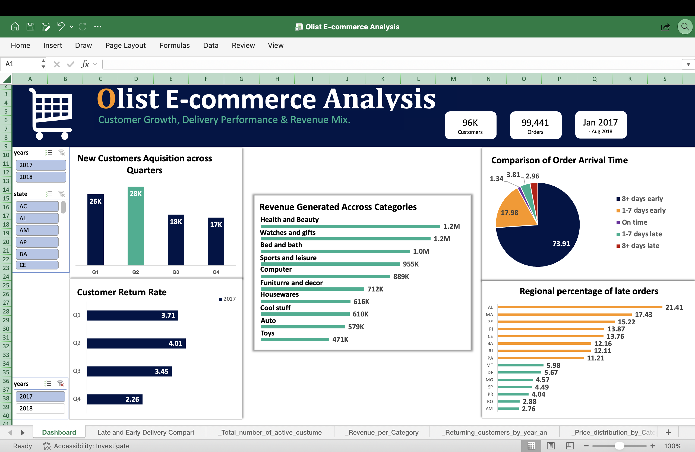

# Olist E-Commerce Analysis: Growth Without Retention

An end-to-end SQL analysis of customer growth, retention, revenue mix and delivery performance on a Brazilian online marketplace, built for the SQL Data Analysis Capstone set by The Data Immersed (TDI) community.

- **Analyst:** Daniel Agbenyo
- **Dataset:** [Brazilian E-Commerce Public Dataset by Olist](https://www.kaggle.com/datasets/olistbr/brazilian-ecommerce) (Kaggle): 99,441 orders from 96,096 customers, 2016–2018
- **Analysis window:** January 2017 to August 2018
- **Tools:** PostgreSQL · Microsoft Excel · PowerPoint · Word
- **Method:** CRISP-DM



---

## 📌 About the project

The TDI capstone brief was to choose a multi-table dataset from a real sector, clean and analyse it entirely in SQL, and present the results through an interactive Excel dashboard, a written report and a presentation.

Olist's public dataset fits that brief well. It holds around 100,000 orders placed on a Brazilian online marketplace between 2016 and 2018, spread across nine related CSV files covering orders, customers, order items, products, sellers, payments, reviews, locations and category names.

Olist doesn't sell its own products or hold stock. It connects small and medium-sized sellers with buyers across Brazil and runs the payments and logistics in between. That shapes which questions matter. They're marketplace questions: is buyer demand growing, do customers come back, where does the revenue actually come from, and does the fulfilment chain keep the delivery date promised at checkout?

The work follows the CRISP-DM process, moving from business and data understanding through preparation, analysis and evaluation. Excel for Mac has no Power Pivot or Data Model, so all of the aggregation happens in PostgreSQL and each dashboard element is fed by a single query result exported as CSV. That means every number in the dashboard, report and presentation traces back to the query that produced it.

---

## 🎯 What we set out to achieve

At its core, the project asks one question: **is Olist's growth healthy?** We wanted an answer backed by figures with clear definitions rather than impressions, and broke the question into four business objectives:

1. **Growth:** establish whether the marketplace is growing, and whether that growth is broadening its customer base or narrowing it.
2. **Retention:** find out whether the customers it acquires come back, and whether retention varies in a way that could be acted on.
3. **Revenue concentration:** identify where revenue comes from, and how much the business depends on a few categories and regions.
4. **Delivery:** measure how reliably orders arrive by the date promised at checkout, and find where that promise breaks.

Those objectives became six analytical questions:

| # | Question | Theme |
|---|---|---|
| Q1 | How many new customers are acquired each quarter, and is growth speeding up or flattening? | Growth |
| Q2 | Where does growth come from geographically, and is it becoming more or less concentrated? | Growth |
| Q3 | What share of each quarter's new customers ever place a second order? | Retention |
| Q4 | Which product categories generate the most revenue, and how concentrated is that revenue? | Revenue mix |
| Q5 | How often do orders arrive after the estimated delivery date, and by how much? | Delivery |
| Q6 | Does delivery performance vary by customer state, and by how much? | Delivery |

The analysis would count as a success if it could state, with figures and definitions: the quarterly growth rate across 2017–2018, whether geographic concentration rose or fell, the repeat-purchase rate for each cohort under at least two definitions, the revenue share of the top ten categories, the national late-delivery rate, and the worst-performing states.

The capstone also set goals of its own:

- Work with a real multi-table dataset and document how the tables relate.
- Do all cleaning and transformation in SQL, so every decision is visible and repeatable.
- Use the full SQL toolkit: exploration, filtering, aggregation, joins, CTEs and subqueries, window functions and `CASE` logic.
- Turn the results into an interactive Excel dashboard, a written report and a presentation that a non-technical audience can act on.

---

## 📖 Project narrative

> **Olist's acquisition engine worked, but almost nobody came back, and growth narrowed instead of spreading.**

The findings fall into three acts:

1. **Acquisition grew fast, then began to slow.** New customers per quarter rose from 5,152 in 2017 Q1 to 19,273 in 2018 Q2, a 3.7x increase. But quarter-on-quarter growth fell from +76% to +18%, and 2018 Q2 was the first quarter to shrink.
2. **The business isn't compounding.** Only 2.2% of customers ever came back for a second order, and even the best quarterly cohort managed just 4.0%. Each quarter's growth was bought one new customer at a time.
3. **Growth is narrowing, and the delivery promise is padded.** São Paulo's share of new customers rose every quarter, from 37% to 45%, and ten of 74 categories earn 62% of revenue. Only 6.8% of orders arrive late, largely because the estimates are generous: the median order arrives 12 days early, yet Alagoas still misses on more than one order in five.

---

## 🗂️ Dataset and schema

The dataset ships as nine CSVs. Eight are loaded into PostgreSQL as related tables. The ninth, `geolocation`, isn't needed for the six questions and is only used in the staged rebuild described under the repository structure. With `orders` (8 columns) at the centre, linked to four other tables, the schema is well above the brief's minimum.

| Table | Rows | Grain | Key |
|---|---|---|---|
| `orders` **(main)** | 99,441 | one order | `order_id` PK, `customer_id` FK |
| `order_items` | 112,650 | one item line | `(order_id, order_item_id)` PK; FKs to orders, products, sellers |
| `order_payments` | 103,886 | one payment | `(order_id, payment_sequential)` PK |
| `order_review` | 99,224 | one review | `(review_id, order_id)` PK |
| `customers` | 99,441 | one customer record per order | `customer_id` PK; `customer_unique_id` is the actual person |
| `products` | 32,951 | one product | `product_id` PK; category FK |
| `sellers` | 3,095 | one seller | `seller_id` PK |
| `product_category_translation` | 71 | one category | `product_category_name` PK |
| `geolocation` | 1,000,163 | one GPS reading | none possible (see G1); not included in this repo |

### Relationship map

```
product_category_translation
          │ product_category_name
          ▼
       products ────────────── product_id ───────────────┐
                                                         ▼
customers ── customer_id ──► orders ── order_id ──► order_items
                               │ order_id                ▲
                               ├──► order_payments       │ seller_id
                               └──► order_review      sellers
```

### The `customer_id` trap

`customers.customer_id` is unique per *order*, not per person: 99,441 `customer_id` values map to 96,096 `customer_unique_id` values. A naive count of `customer_id` would report 3,345 customers who don't exist; that gap is the extra orders placed by returning customers. Every customer-level figure in this project counts distinct `customer_unique_id` instead. The duplicate records weren't deleted, because removing them would orphan the orders that join on `customer_id` and erase the repeat-purchase signal, so de-duplication happens at query time.

---

## 🧹 Data quality: issues found and how they were handled

Every file was profiled before any analysis. The issues below were found in the raw data and dealt with in SQL; the source CSVs are kept as downloaded.

### Issues that blocked loading

| # | Issue | How it was handled |
|---|---|---|
| F1 | Empty category fields in the products file imported as empty strings rather than NULL, so the products → category foreign key rejected them | Dropped the constraint, loaded the data, converted blanks to NULL, then restored the constraint |
| F2 | Two categories used by products (`pc_gamer`, `portateis_cozinha_e_preparadores_de_alimentos`) are missing from the translation file | Added to the translation table before products are loaded |
| F3 | Product `a41e356c76fab66334f36de622ecbd3a` is referenced by `order_items` but had been deleted from an edited copy of the products file | Restored the original file; `02_load.sql` stops with an error if that row is missing |
| R1 | Review comments contain line breaks, so the reviews file has 104,719 physical lines but only 99,224 records | Loaded as quoted CSV, with the record count asserted after loading |
| G1 | `geolocation` holds 1,000,163 GPS readings for 19,015 zip prefixes, and even whole rows repeat (261,831 exact duplicates), so no primary key is possible | In the staged rebuild, deduplicated and collapsed to one row per prefix: median coordinates inside Brazil's bounding box and the most common city and state spelling |

### Cleaning decisions

| # | Issue | Decision |
|---|---|---|
| N1 | 610 products (1.9%) have no category and no name, description or photo data | Kept and labelled `unknown`; they carry R$170,727 (1.3%) of revenue |
| N2 | 2 products have no weight or dimensions | Left NULL. Columns the questions don't use (product dimensions, zip prefixes, review comment text) were dropped from the analysis tables |
| N3 | 2,965 orders never reached the customer (cancelled, unavailable or still in transit) | Delivery and revenue analysis uses only delivered orders with a delivery date: 96,470 orders |
| N4 | 160 orders have no approval timestamp; 1 order has no payment record; 9 payments are R$0 and 3 have payment type `not_defined` | Noted; none of these affect the six questions. `not_defined` is recoded to `unknown` with `CASE` in the staged rebuild |
| N5 | 789 `review_id` values appear more than once, and 547 orders have more than one review | Composite primary key `(review_id, order_id)` |
| N6 | The date range is thin at both ends: 2016 has 326 customers over a partial year, and the data stops partway through 2018 Q3 | Trends run from January 2017; 2016 is excluded and 2018 Q3 is flagged as partial |
| N7 | Two orders placed minutes apart are usually one shopping session split across sellers, not a returning customer | A repeat purchase must come more than 24 hours after the previous order (`LAG()`); a fixed 90-day window was used as a cross-check |
| N8 | The estimated delivery date has no time component | Lateness is judged on calendar dates, so an evening delivery on the promised day counts as on time |
| N9 | Early deliveries produce negative "days vs estimate" values that cancel out late ones in an average | Late rate, lateness among late orders and earliness among early orders are reported as three separate figures |
| N10 | City names are spelled inconsistently (`sao paulo` vs `são paulo`, apostrophe variants, `city/state` suffixes) | Audited in `03a_city_audit.sql` and standardised by a `norm_city()` function in the staged rebuild |

### Load order (foreign-key safe)

```
product_category_translation  →  sellers  →  products  →  customers
      →  orders  →  order_items  →  order_payments  →  order_review
```

---

## 🛠️ SQL techniques used

The brief asks for at least two examples of each core SQL category, plus `CASE` statements, CTEs and subqueries. Each question needed its own technique, so between them the scripts cover all of them.

| Category | Where it's used |
|---|---|
| Data exploration | Null audit on `orders`; duplicate check on `geolocation`; distinct counts of customers, cities and zip prefixes; count of `unknown` categories; full pre-clean audit in `03_cleaning.sql` |
| Filtering and sorting | Delivered-only filters, date windows, ordered outputs throughout, and `LIMIT` for the top 5 customer cities |
| Aggregation (`GROUP BY` / `HAVING`) | Customers by year, quarter and state; revenue, items and prices by category; `HAVING COUNT(*) >= 100` for states and `>= 30` for category price statistics |
| Joins | `customers` ↔ `orders` (Q1–Q3, Q6); `order_items` ↔ `products` ↔ `product_category_translation` ↔ `orders` (Q4), with a `LEFT JOIN` and `COALESCE` so uncategorised products aren't lost |
| CTEs and subqueries | First-order CTEs (Q1, Q2); order-sequence and customer-summary CTEs (Q3); item revenue and price CTEs (Q4); delivery-metric CTEs (Q5); a subquery in the duplicate check |
| Window functions | Running total with `SUM(COUNT(*)) OVER (...)` (Q1); `ROW_NUMBER()` to pin each customer to their first order (Q2); `LAG()` for the time since a customer's previous order (Q3); revenue share with `SUM(SUM(price)) OVER ()` (Q4); share of orders per delivery bin (Q5) |
| `CASE` statements | 24-hour repeat-purchase flag (Q3); delivery-timing bins from "15+ days early" to "15+ days late" (Q5) |
| Statistics in SQL | `COUNT(*) FILTER (WHERE ...)`, `PERCENTILE_CONT(0.5)` medians and `STDDEV_SAMP` for lateness severity and price spread (Q4, Q5) |

---

## 📊 Key findings

Trends cover January 2017 to August 2018. Revenue means item price on delivered orders, excluding freight. A customer is a distinct `customer_unique_id`.

**Growth and acquisition (Q1, Q2)**
- New customers per quarter rose from 5,152 (2017 Q1) to 19,273 (2018 Q2), a 3.7x increase.
- Growth was slowing: quarter-on-quarter growth fell from +76.4% to +18.4%, and 2018 Q2 was the first quarter to shrink (−5.7%).
- São Paulo's share of new customers rose in every full quarter, from 37.4% to 45.1%. São Paulo, Rio de Janeiro and Minas Gerais account for 41.4%, 13.0% and 11.8% of customers acquired, and the top five states for about 77%.

**Retention (Q3)**
- Only 2,110 of 95,769 customers (2.2%) placed a second order. The best cohort, 2017 Q2, reached 4.0%.
- Later cohorts look worse partly because they had less time to return before the data ends. The fair reading is that repeat purchase is uniformly low, not that it's falling.

**Revenue mix (Q4)**
- Item revenue totals R$13,221,498 across 74 categories. The top 10 categories earn 62.4% of it, and the top 15 earn 76.3%.
- Category size is driven by volume, not price: median item prices across the top 10 range from about R$60 to R$130. Health & beauty leads with 9,465 items sold at a median of R$79.90.
- Averages overstate typical prices. Health & beauty averages R$130.28 because a thin tail of items priced up to R$3,124 pulls it up, so medians are used wherever one figure has to stand for a category.

**Delivery (Q5, Q6)**
- 6,534 of 96,470 delivered orders (6.8%) arrived after the estimated date.
- The estimate is padded: 73.9% of orders arrived 8 or more days early, and the median order beat its estimate by 12 days.
- Late orders are very late: a median of 7 days, a mean of 10.6 and a worst case of 188.
- Lateness is regional. Alagoas misses its estimate on 21.4% of orders, 4.8x São Paulo's 4.5%, and seven of the eight worst states are in the North and North-east.
- Rio de Janeiro is the exception that matters most: 12.1% late on 12,350 orders, or 1,495 late deliveries, 23% of the national total.
- Speed and lateness aren't the same thing. Amazonas has the slowest deliveries (26.4 days on average) but misses its estimate only 2.8% of the time, because its estimates allow for the distance.
- Black Friday (24 November 2017) was the busiest day in the data, with 1,176 orders, about 5.5x a typical November day. A supporting query looked at whether that surge worsened delays; the result is treated as directional only.

---

## 💡 Recommendations

Each recommendation is tied to a figure above. Where the data can't support a recommendation, that's stated plainly.

1. **Find out whether the retention ceiling is structural.** In a marketplace the seller, not the platform, owns the relationship after purchase, so a low repeat rate may be built into the model. Before spending on retention, compare repeat rates across sellers and restockable categories such as health & beauty, pet supplies and perfumery. If some segment returns noticeably more often, retention is fixable and that segment shows how. If the rate is flat at 2–4% everywhere, the money belongs in acquisition efficiency instead.
2. **Track share, not just volume.** São Paulo's rising share was invisible in the absolute numbers, which grew everywhere. Standing metrics for state share and top-10 category share would flag concentration as it builds.
3. **Fix the worst states before touching the estimate.** The eight worst states miss their estimates on 11–21% of orders. Seven are in the North and North-east, and Rio de Janeiro deserves priority because of its size.
4. **Reconsider the delivery estimate deliberately.** A 12-day median buffer gives buyers a weak promise. Tightening it trades a sharper promise for a higher visible late rate, so it's worth testing first in states that already deliver well.
5. **Be clear about what this data can't answer.** There's no marketing, cost or channel data, so acquisition cost and lifetime value are out of reach. Sellers are anonymised IDs, so concentration can be measured but not attributed to particular merchants.

---

## ⚠️ Limitations and next steps

**Limitations**
- Twenty months of data is too short to judge long-run retention, and each cohort had a different amount of time to return.
- 2016 (326 customers over a partial year) is excluded, and 2018 Q3 is incomplete.
- With no marketing, cost or channel data, acquisition cost and lifetime value can't be assessed.
- Revenue excludes freight and undelivered orders, so it's lower than gross order value.
- Known inconsistency: 2018 Q3 new customers appear as 6,071 on the cumulative and state sheets but 12,347 on the cohort sheet, because those queries end on 31 July 2018 and 30 September 2018 respectively. Q3 is left out of every trend statement, so no conclusion changes.

**Next steps**
- Join reviews to delivery outcomes to measure how much each day of lateness costs in review score.
- Test repeat rates by seller and by category (recommendation 1).
- Break delivery into stages (approval, carrier handover, final delivery) to see where regional delays start.
- Align the 2018 Q3 date cut-off and re-export the affected sheets.
- Analyse instalment payments, a distinctive feature of Brazilian e-commerce.

---

## 📁 Deliverables and repository structure

- **Excel dashboard** (`Olist E-commerce Analysis.xlsx`): a one-page dashboard that reads left to right as an argument, moving from scale to growth, retention, revenue concentration and delivery, with slicers for year and state. The query results behind it sit on their own sheets.
- **Report** (`Olist_Analysis_Report.docx`): the full write-up, structured on CRISP-DM, covering the data, the preparation decisions, the findings, the dashboard design, recommendations and limitations.
- **Presentation** (`Olist_Analysis_Presentation.pptx`): ten slides telling the same story for a non-technical audience.
- **SQL scripts** (`Scripts/`): the schema, cleaning and analysis, commented throughout.

```
SQL Capstone/
├── Kaggle Brazilian E-commerce Public Dataset/   source CSVs, kept as downloaded
├── Scripts/
│   ├── DDL.sql                  schema used for the analysis: 8 tables with primary and foreign keys
│   ├── DML.sql                  cleaning steps, then every analysis query, grouped by theme
│   ├── 00_restore_raw_data.sh   checks out the unedited products and geolocation files from git
│   ├── 01_ddl.sql               staged rebuild: staging and olist schemas, constraints, helper function
│   ├── 02_load.sql              staged rebuild: loads the raw CSVs and checks every row count
│   ├── 03_cleaning.sql          staged rebuild: staging → clean tables, every decision commented
│   └── 03a_city_audit.sql       read-only audit of inconsistent city spellings
├── Pivot Tables/                14 query results exported as UTF-8 CSV and imported into Excel
├── img/                         dashboard screenshot used in this README
├── Olist E-commerce Analysis.xlsx       Excel dashboard
├── Olist_Analysis_Report.docx           written report
├── Olist_Analysis_Presentation.pptx     presentation
├── TDI SQL DATA ANALYSIS CAPSTONE.pdf   capstone brief
└── README.md
```

### Two sets of SQL scripts

The analysis runs on `DDL.sql` and `DML.sql`, and every figure in the dashboard, report and presentation comes from a query in `DML.sql`. Scripts `00` to `03a` are a stricter, fully scripted rebuild of the same data: raw CSVs land in a `staging` schema with no constraints, then `03_cleaning.sql` moves them into constrained tables in an `olist` schema, with each cleaning decision documented next to the code and row counts asserted at every step. One difference to be aware of: its `is_late` flag compares full timestamps, so orders delivered on the estimated day count as late there (8.1% overall), whereas the analysis compares calendar dates (6.8%).

---

## ▶️ How to reproduce

**The analysis**

1. Create a PostgreSQL database and run `Scripts/DDL.sql`.
2. Insert the two missing categories (the first statement in `Scripts/DML.sql`) so the products foreign key accepts them.
3. Load each CSV into its table in the load order above, using psql's `\copy ... WITH (FORMAT csv, HEADER true)` or your SQL client's import tool. If the tool imports empty fields as empty strings rather than NULL, the products load will fail (see F1).
4. Run the rest of `DML.sql`: the remaining cleaning steps, the analysis queries (grouped into growth and acquisition, delivery performance, and revenue and product mix), then the data checks at the end. The duplicate check on `geolocation` needs that table, which isn't part of this schema.
5. Export each result as UTF-8 CSV (other encodings break accented Brazilian place names) and import it into Excel with **Data → Get Data → From Text/CSV**.

**The staged rebuild (optional)**

This needs PostgreSQL 13 or later, for `normalize()`, and the `olist_geolocation_dataset.csv` file from Kaggle placed in the dataset folder.

```bash
createdb olist_capstone
psql -d olist_capstone -f Scripts/01_ddl.sql
psql -d olist_capstone -f Scripts/02_load.sql   # update the folder path inside this file first
psql -d olist_capstone -f Scripts/03_cleaning.sql
```

`02_load.sql` and `03_cleaning.sql` check row counts against the profiled source files and stop if anything doesn't match.

---

*Data: Brazilian E-Commerce Public Dataset by Olist, via Kaggle.*
